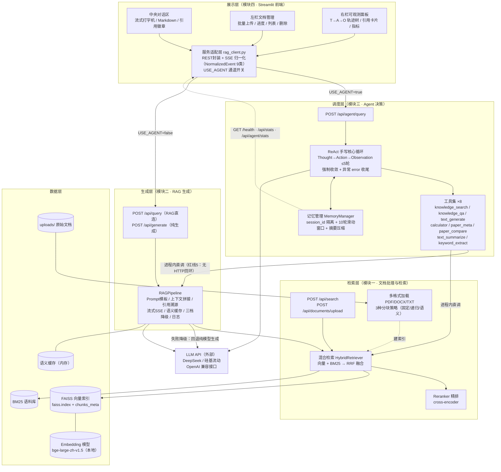
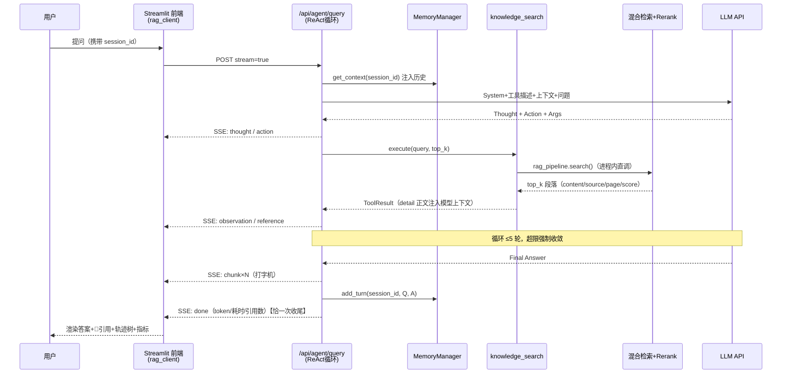
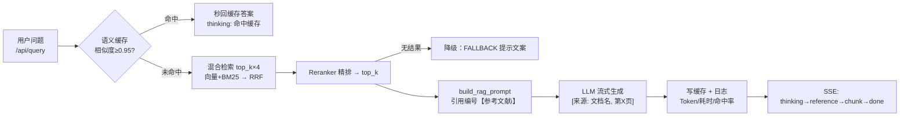

# 系统架构图（交付书 4.4.1 / 第五章 5.1 素材）

> 绘制：模块四 ｜ 2026-09-30 ｜ 工具：Mermaid（交付书可用支持 Mermaid 的编辑器直接渲染，或粘贴至 draw.io / mermaid.live 导出 PNG）
> 分层与文字描述遵循《项目交付模板》："系统分为五层：展示层（Streamlit界面）、调度层（Agent决策）、生成层（RAG流水线）、检索层（混合检索+重排序）、数据层（向量数据库+文档存储）。各层通过标准化接口交互。"

## 图一：五层架构总览

## 图二：核心数据流时序（Agent 通道一轮问答）

## 图三：RAG 直连通道（USE_AGENT=false，数据流对照）

## 交付书嵌入说明

- 4.4.1 用**图一**（五层架构）+ 模板既有文字描述；
- 第五章 5.2 模块接口定义可直接引用接口表（`docs/module4_design.md` §3），5.3 核心数据流向用**图二/图三**；
- 渲染导出：把 mermaid 代码块贴入 [mermaid.live](https://mermaid.live) → Export PNG/SVG → 插入 Word。
